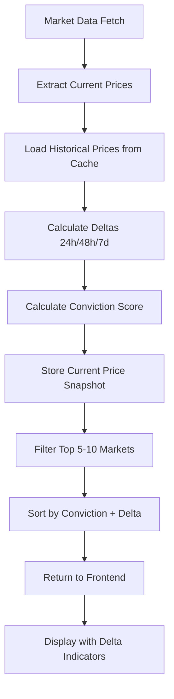

<!-- 7e7bb28e-0ece-417e-bb1f-fc6695e74de1 e1281e0b-bf45-4a65-b106-07875a79cc1c -->
# Prediction Markets Card Enhancement Plan

Transform the prediction markets card into a belief-pricing signal engine that shows traders where expectations are shifting, not just static probabilities.

## Core Objectives

1. **Historical Price Tracking**: Store price snapshots to calculate probability deltas (Δ%)
2. **Conviction Scoring**: Volume-normalized confidence metrics
3. **Aggressive Curation**: Reduce from 50 to **5-10 macro-critical markets** (strict target)
4. **Delta Display**: Show 24h, 48h, 7d probability changes in UI
5. **Visual Signal Emphasis**: Highlight significant probability shifts and high-conviction markets

## Architecture Changes

### Data Flow Enhancement



### Historical Price Storage Schema

Extend cache structure to include historical snapshots:

```json
{
  "markets": [...],
  "price_history": {
    "market_id_1": [
      {"timestamp": "2024-01-15T10:00:00Z", "yes_price": 0.65, "no_price": 0.35},
      {"timestamp": "2024-01-14T10:00:00Z", "yes_price": 0.58, "no_price": 0.42}
    ]
  },
  "timestamp": "..."
}
```

## Implementation Steps

### Phase 1: Historical Price Tracking (Backend)

#### 1.1 Extend Cache Schema for Price History

**File**: `backend/services/prediction_markets_service.py`

- Modify `_save_cache()` to store price snapshots with timestamps
- Modify `_load_cache()` to load historical price data
- Add `_store_price_snapshot(market_id, yes_price, no_price, timestamp)` method
- Add `_load_price_history(market_id, days=7)` method to retrieve historical snapshots

**Context**: Currently `_save_cache()` only stores current markets. Need to maintain a rolling history of price snapshots (keep last 30 days).

#### 1.2 Add Delta Calculation Methods

**File**: `backend/services/prediction_markets_service.py`

- Add `_calculate_price_deltas(market_id, current_price, price_history)` method
- Calculate deltas: 24h, 48h, 7d (using closest available historical price)
- Return structure: `{"delta_24h": 5.2, "delta_48h": 8.1, "delta_7d": -3.4}`
- Handle edge cases: missing history, resolved markets, new markets

**Context**: Advisor emphasized "Sharp probability deltas (Δ%)" and "time-based repricing (+12% in 48 hours)" as high-value signals.

#### 1.3 Integrate Delta Calculation into Normalization

**File**: `backend/services/prediction_markets_service.py`

- Modify `_normalize_market_data()` to:

  1. Store current price snapshot after normalization
  2. Load price history before normalization
  3. Calculate deltas using historical prices
  4. Add delta fields to normalized market: `price_delta_24h`, `price_delta_48h`, `price_delta_7d`

**Context**: Currently `_normalize_market_data()` only extracts current prices. Need to compare against history and store for next time.

### Phase 2: Conviction Scoring (Backend)

#### 2.1 Implement Volume-Based Conviction Score

**File**: `backend/services/prediction_markets_service.py`

- Add `_calculate_conviction_score(volume, market_age, liquidity_score=None)` method
- Normalize volume thresholds:
  - High conviction: volume > $50k
  - Medium conviction: $10k < volume <= $50k  
  - Low conviction: volume <= $10k
- Return normalized score (0-100) for sorting and UI display

**Context**: Advisor stated "A 40% probability with $5k volume ≠ 40% with $5m volume" - need conviction weighting.

#### 2.2 Add Conviction Score to Market Data

**File**: `backend/services/prediction_markets_service.py`

- Modify `_normalize_market_data()` to calculate conviction score
- Add `conviction_score` field (0-100) to normalized market
- Add `conviction_level` field ("high", "medium", "low") for UI styling

**Context**: Enables visual de-emphasis of weak markets and prioritization of high-conviction signals.

### Phase 3: Aggressive Market Curation

#### 3.1 Reduce Market Limit

**File**: `backend/services/prediction_markets_service.py`

- Change `MAX_FILTERED_MARKETS = 50` to `MAX_FILTERED_MARKETS = 10` (line 92)
- Add enforcement logic to ensure 5-10 markets are returned (if fewer than 5 available, show all; if more than 10 pass filtering, take top 10)
- Context: Strict target of 5-10 macro-critical prediction markets

#### 3.2 Enhance Sorting Logic

**File**: `backend/services/prediction_markets_service.py`

- Modify sorting in `_filter_economic_markets()` (around line 1487):
  - Primary: Conviction score (high to low)
  - Secondary: Price delta magnitude (absolute value, high to low) - surfaces shifting markets
  - Tertiary: Priority score (curated markets)
  - Quaternary: Volume (high to low)

**Context**: Currently sorts by volume first. New logic prioritizes conviction + delta to show "belief shifts" first.

#### 3.3 Tighten Curated Markets List (Optional)

**File**: `backend/services/curated_prediction_markets.py`

- Review and prioritize top 5-10 market categories
- Focus on: Fed/FOMC, CPI, NFP, ECB, BOE (with BOJ/GDP/political as additional if needed)
- Ensure final filtered list produces 5-10 macro-critical markets

**Context**: Strict target of 5-10 markets - prioritize highest-value categories.

### Phase 4: Frontend Display Enhancements

#### 4.1 Add Delta Display to Market Items

**File**: `src/components/Overview.jsx`

- Modify market item rendering (around line 3631) to display:
  - Probability delta badges (24h change) with color coding:
    - Green: significant increase (+5% or more)
    - Red: significant decrease (-5% or more)  
    - Gray: minimal change (<5%)
  - Format: "+12%" or "-8%" next to probability bar
- Add tooltip showing 24h, 48h, 7d deltas on hover

**Context**: Visual indicators of "expectation shifts" that advisors identified as high-value.

#### 4.2 Add Conviction Indicators

**File**: `src/components/Overview.jsx`

- Display conviction level badge (High/Medium/Low) or visual indicator
- Apply opacity/styling based on conviction (low conviction markets appear dimmer)
- Show conviction score in market metadata row

**Context**: Visual de-emphasis of weak markets protects credibility (advisor recommendation).

#### 4.3 Enhance Market Item Styling

**File**: `src/components/Overview.css`

- Add styles for delta badges: `.price-delta`, `.price-delta.positive`, `.price-delta.negative`
- Add styles for conviction indicators: `.conviction-badge`, `.conviction-high`, `.conviction-low`
- Reduce opacity for low-conviction markets: `.prediction-market-item.low-conviction { opacity: 0.7; }`

**Context**: Visual hierarchy emphasizes high-value signals (conviction + delta).

### Phase 5: Data Structure Updates

#### 5.1 Update Frontend Hook to Handle New Fields

**File**: `src/hooks/usePredictionMarkets.js`

- Ensure hook passes through new fields: `price_delta_24h`, `conviction_score`, `conviction_level`
- No changes needed if hook already passes all fields from API response

#### 5.2 Update API Response Format (Backend)

**File**: `backend/services/prediction_markets_service.py`

- Verify `_normalize_market_data()` returns include new fields:
  - `price_delta_24h`, `price_delta_48h`, `price_delta_7d`
  - `conviction_score`, `conviction_level`
- Ensure `get_prediction_markets()` includes these in response

## Testing Considerations

1. **Historical Data**: Test delta calculation with missing history (new markets)
2. **Cache Migration**: Handle migration of existing cache to new schema with price_history
3. **Edge Cases**: Resolved markets, markets with no volume, zero deltas
4. **Performance**: Price history storage should not significantly slow cache save/load

## Future Enhancements (Out of Scope for V1)

- **Belief Shift Alerts**: Automated alerts when probability moves beyond threshold (Phase 2)
- **Cross-Market Divergence**: Compare prediction markets vs rates markets (Phase 3)
- **WebSocket Integration**: Real-time price updates for live deltas (Phase 4)
- **Integration with Macro Narratives**: Embed probabilities into existing analysis (Phase 5)

## Key Files to Modify

1. `backend/services/prediction_markets_service.py` - Historical tracking, delta calculation, conviction scoring, market limit
2. `src/components/Overview.jsx` - Delta display, conviction indicators
3. `src/components/Overview.css` - Delta badge styles, conviction styling
4. `backend/services/curated_prediction_markets.py` - Optional: tighten curated list

## Success Metrics

- Card shows 5-10 markets (down from 50, with enforcement to maintain range)
- All markets display probability deltas (24h minimum)
- Markets sorted by conviction + delta magnitude (shifting markets first)
- Visual hierarchy clearly distinguishes high-conviction signals

## Notes

- Historical price storage can use existing Firebase cache or file cache (no new infrastructure)
- Delta calculation uses closest available historical price (handles sparse snapshots)
- Conviction scoring is volume-based initially (can enhance with orderbook depth later)
- Market limit reduction may require cache pruning for existing deployments

### To-dos

- [ ] Extend cache schema to store price snapshots with timestamps. Add _store_price_snapshot() and _load_price_history() methods in prediction_markets_service.py
- [ ] Implement _calculate_price_deltas() method to compute 24h, 48h, 7d probability changes from historical prices
- [ ] Modify _normalize_market_data() to load historical prices, calculate deltas, and store current price snapshot
- [ ] Add _calculate_conviction_score() method based on volume thresholds (high >$50k, medium $10k-$50k, low <=$10k)
- [ ] Integrate conviction score calculation into _normalize_market_data() to add conviction_score and conviction_level fields
- [ ] Change MAX_FILTERED_MARKETS from 50 to 10 in prediction_markets_service.py line 92, add enforcement for 5-10 range
- [ ] Update sorting in _filter_economic_markets() to prioritize conviction score + delta magnitude over raw volume
- [ ] Add probability delta badges (24h change) to market items in Overview.jsx with color coding for positive/negative changes
- [ ] Add conviction level badges and visual styling (opacity) to market items based on conviction_score in Overview.jsx
- [ ] Add CSS styles for delta badges (.price-delta.positive/.negative) and conviction indicators (.conviction-badge) in Overview.css