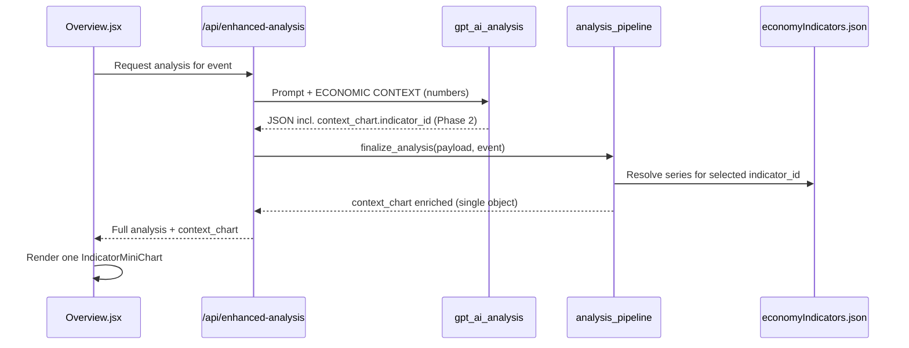

# Calendar Analysis — Indicator Mini-Charts Plan

**Status:** Planning  
**Created:** 2026-05-28  
**Purpose:** Add Economies-style indicator charts to Economic Calendar AI analysis — miniaturized, same visual language, embedded in the analysis panel.

**Related docs:**
- [ECONOMIES_DATA_AI_INTEGRATION.md](./ECONOMIES_DATA_AI_INTEGRATION.md) — backend context injection (mostly shipped)
- [HOLISTIC_SCAN_STYLE_REFERENCE.md](./HOLISTIC_SCAN_STYLE_REFERENCE.md) — pattern for transferring Economies visuals into Overview
- [FXSentinel_AI_Analysis_Review.md](./FXSentinel_AI_Analysis_Review.md) — trust/quality tracker (V2-CA1 surprise history is a *later*, separate feature)

---

## 1. Problem

Calendar analysis is **text-heavy**. GPT already receives macro indicator values (current, average, trend) via `ECONOMIC CONTEXT FOR {currency}` in the prompt, but traders **cannot see the same time-series charts** they trust on the Economies tab.

For releases like **Core PCE**, **CPI**, **NFP**, or **ECB rate decisions**, a mini chart answers questions prose hides poorly:

- Is inflation **re-accelerating** or **disinflating**?
- Is unemployment **drifting up** from a low base?
- Where is the policy rate vs the last 12–24 months?

**Goal:** Show **one** relevant indicator chart inside `ai-analysis-content` (Overview), using the **same styling** as Economies — miniaturized for the analysis scroll panel.

**Selection rule (locked):** The calendar event already carries a **country / economy code** (or currency we map to one). Each supported economy has **exactly six** indicators in `economyIndicators.json`. We pick the **single most useful** indicator for *this* release — not two.

---

## 2. Goals & non-goals

### Goals

| # | Goal |
|---|------|
| G1 | Reuse Economies chart **visual tokens** (red line, glow, grid, gradient fill, target line for inflation) |
| G2 | Miniaturize for the analysis card (~100–120px chart height vs 180px on Economies) |
| G3 | Data comes from **`economyIndicators.json`** only — no GPT-generated series |
| G4 | Show chart only when event economy is **US, EUR, GBP, or JPY** (six indicators each) |
| G5 | Place chart **early** in analysis (after headline / confidence, before scenarios) |
| G6 | Display **`asOf`** date and source so stale data is honest |
| G7 | **Exactly one** chart per analysis — no dual-chart layout |

### Non-goals (this project)

| # | Out of scope |
|---|--------------|
| NG1 | Event **surprise history** (last 4–6 prints of *this* release) — needs separate data (V2-CA1) |
| NG2 | Charts for **AUD, CAD, CHF, NZD** until economy indicator datasets exist |
| NG3 | OHLC / technical **key levels** on charts (V1 #8 deferred) |
| NG4 | Live News or Holistic Scan charts (calendar first; same component can be reused later) |
| NG5 | Expandable modal chart (Economies has this; analysis uses compact inline only in v1) |

---

## 3. Current state (what already exists)

### Data

| Asset | Location | Notes |
|-------|----------|-------|
| Indicator time series | `src/data/economyIndicators.json` | 6 indicators × 4 economies; `chartData`, `chartDates`, `currentValue`, `asOf` |
| Economy context API (backend) | `backend/services/economy_context_service.py` | Reads same JSON |

**Per-economy indicator IDs:**

| Economy | IDs |
|---------|-----|
| US | `interest-rate`, `inflation-YoY`, `core-inflation-YoY`, `gdp-growth`, `unemployment`, `nonfarm-payrolls` |
| EUR | `interest-rate`, `inflation`, `core-inflation-YoY`, `gdp-growth`, `unemployment`, `current-account` |
| GBP | `interest-rate`, `inflation`, `core-inflation-YoY`, `gdp-growth`, `unemployment`, `wage-growth` |
| JPY | `interest-rate`, `inflation`, `core-inflation-YoY`, `gdp-growth`, `unemployment`, `current-account` |

### Backend (calendar prompt)

| Piece | Location | Status |
|-------|----------|--------|
| Event title → concept → indicator IDs | `gpt_ai_analysis.py` — `TITLE_KEYWORD_TO_CONCEPT`, `CONCEPT_TO_INDICATORS_BY_CURRENCY`, `_get_relevant_indicators()` | ✅ Shipped |
| Filtered economy context in prompt | `_get_economy_context()`, `_format_economy_context_for_prompt()` | ✅ Shipped (numbers + stats, no chart payload) |
| Policy targets (2% inflation, etc.) | `POLICY_TARGETS` in `gpt_ai_analysis.py` | ✅ Shipped |

### Frontend

| Piece | Location | Status |
|-------|----------|--------|
| Full indicator cards + SVG charts | `Economies.jsx` + `Economies.css` | ✅ Reference implementation |
| Calendar analysis panel | `Overview.jsx` — `.ai-analysis-content.fx-analysis-output` | ✅ Text only; no macro charts |
| Style transfer precedent | `HOLISTIC_SCAN_STYLE_REFERENCE.md` | ✅ Pattern for Economies → Overview |

---

## 4. Proposed architecture

### Principle: country-scoped pool → pick one best indicator

```text
Calendar event (country_code / currency already on event)
    │
    ├─► Normalize → economy key for JSON (US | EUR | GBP | JPY)
    │
    ├─► Load all 6 indicator IDs for that economy (fixed catalog)
    │
    ├─► Rank by event title / type → single best indicator_id
    │       (e.g. Core PCE → core-inflation-YoY, NFP → nonfarm-payrolls)
    │
    ├─► Backend finalize: attach one chart payload from economyIndicators.json
    │
    └─► Frontend: render one IndicatorMiniChart (analysis-compact)
```

**GPT must never output chart numbers or dates.** Phase 2 (optional): GPT may pick **one** `indicator_id` from the six allowed for that country — validated server-side.

### Country code on the event

Calendar events already expose economy identity. Use in this order:

1. **`event.country_code`** or **`event.country`** if present (normalize aliases — see below)
2. Else **`event.currency`** → map via `CURRENCY_TO_COUNTRY` (`analysis_context_pack.py` / `economy_context_service.py`)

**Normalize to `economyIndicators.json` keys:**

| Event field examples | JSON economy key |
|----------------------|------------------|
| `US`, `USD` | `US` |
| `EUR`, `EU`, `EUR` (currency) | `EUR` |
| `GBP`, `GB`, `UK` | `GBP` |
| `JPY`, `JP` | `JPY` |

> **Note:** Hybrid calendar sometimes emits `country: "EU"` / `"GB"` / `"JP"`. Finalize must map these to `EUR` / `GBP` / `JPY` before loading indicators. Unsupported economies (AUD, CAD, …) → **no chart** (`context_chart: null`).

### Data flow diagram



---

## 5. API contract

### GPT output (Phase 2 — optional)

```json
{
  "context_chart": {
    "indicator_id": "core-inflation-YoY",
    "caption": "Core trend vs 2% target drives Fed repricing."
  }
}
```

**Rules:**
- `indicator_id` must be one of the **six** IDs for the event’s economy (listed in the prompt).
- **Exactly one** ID — no secondary chart.
- Caption optional; max ~120 chars.

### Final API field (after finalize — source of truth for UI)

```json
{
  "context_chart": {
    "id": "core-inflation-YoY",
    "title": "Core CPI (YoY)",
    "currentValue": "3.2%",
    "asOf": "2026-04-01",
    "unit": "%",
    "source": "Bureau of Labor Statistics",
    "chartData": [3.1, 3.2, "..."],
    "chartDates": ["2024-01-01", "..."],
    "caption": "Core trend vs 2% target drives Fed repricing.",
    "showTargetLine": true,
    "targetValue": 2.0,
    "selection_source": "deterministic"
  },
  "context_chart_meta": {
    "economy": "US",
    "currency": "USD",
    "country_code_resolved": "US",
    "allowed_indicator_ids": [
      "interest-rate",
      "inflation-YoY",
      "core-inflation-YoY",
      "gdp-growth",
      "unemployment",
      "nonfarm-payrolls"
    ],
    "selected_indicator_id": "core-inflation-YoY"
  }
}
```

When no supported economy or no match: `"context_chart": null` (UI hides section).

**`selection_source` values:** `deterministic` | `gpt` | `gpt_fallback` (invalid GPT id → deterministic best match).

### Phase 1 shortcut

Skip GPT. Finalize calls `pick_best_indicator_for_event(country_code, event_title)` → one payload from JSON.

---

## 6. Visual design spec (miniaturized Economies)

Reference: `Economies.css` — `.mini-chart`, `.chart-path`, `.chart-path-glow`, `.chart-area`, `.chart-grid-line`, `.chart-target-line`.

### Size variants

| Variant | Context | Chart height | Y-axis labels | Hover tooltip |
|---------|---------|--------------|---------------|---------------|
| **economies** (existing) | Economies tab card | 180px | Full | Yes |
| **analysis-compact** (new) | Calendar analysis | **100–120px** | Reduced (min/max/current only) | Yes (lightweight) |

### Design tokens (unchanged from Economies)

| Token | Value |
|-------|-------|
| Line stroke | `#da0012` |
| Glow | `#da0012` @ 25% opacity, blur |
| Area gradient | `rgba(255, 59, 48, 0.4)` → transparent |
| Grid | `rgba(255, 255, 255, 0.04)` |
| Chart background | `rgba(0, 0, 0, 0.2)` |
| Border | `1px solid rgba(255, 255, 255, 0.05)` |
| Inflation target line | `#ff6b74` dashed @ 2% (when `showTargetLine`) |

### Compact card layout (per chart)

```text
┌─────────────────────────────────────────┐
│ Core CPI (YoY)              3.2%        │  ← title + currentValue
│ as of 2026-04-01                        │  ← muted asOf
├─────────────────────────────────────────┤
│  [mini SVG chart ~110px tall]           │
│  ─ ─ ─ 2% target (inflation only)       │
├─────────────────────────────────────────┤
│ Core trend vs 2% target drives…         │  ← optional caption (GPT or static)
└─────────────────────────────────────────┘
```

### Placement in Overview analysis

**v1 position (locked):** after **Market Scenarios**, **before** **In-depth analysis**.

Rationale: trader reads headline → confidence → probability scenarios → directional table, then sees **macro trend context** before the long-form narrative blocks.

```text
quick-scan-headline
ai-overview                         ← confidence bars
forward-scenarios-section           ← probability scenarios
market-scenarios-section            ← Above / On / Below table
analysis-context-chart-section      ← NEW (one mini chart) ★
in-depth-analysis-section           ← release, reaction, plan, big picture
```

### CSS namespace

New BEM-style prefix to avoid collisions: `.analysis-context-chart*`  
Shared SVG classes can remain `.chart-path`, `.chart-path-glow` scoped under `.analysis-context-chart .mini-chart`.

Add styles to **`Overview.css`** (analysis panel owner), not Economies.css — but duplicate minimal rules or import a shared **`IndicatorChart.css`**.

---

## 7. Frontend component plan

### New shared module

| File | Responsibility |
|------|----------------|
| `src/components/charts/indicatorChartUtils.js` | `normalizeSeries`, `generateLinePath`, `generateAreaPath`, `generateYAxisLabels`, `generateXAxisLabels` — extracted from `Economies.jsx` |
| `src/components/charts/IndicatorMiniChart.jsx` | Props-driven SVG chart; `variant="economies" \| "analysis-compact"` |
| `src/components/charts/IndicatorChart.css` | Shared chart tokens (imported by Economies + Overview) |
| `src/components/analysis/AnalysisContextChart.jsx` | Renders single `context_chart` object (or null) |

### Refactor Economies (Phase 1b, same PR or follow-up)

Replace inline chart logic in `Economies.jsx` with `<IndicatorMiniChart />` so **one implementation** drives both surfaces.

### Overview integration

In `Overview.jsx`, inside `aiAnalysisState === 'event-analysis'`:

```jsx
{aiAnalysis.context_chart && (
  <AnalysisContextChart chart={aiAnalysis.context_chart} />
)}
```

---

## 8. Backend plan

### New service

**`backend/services/analysis_context_charts.py`**

| Function | Purpose |
|----------|---------|
| `resolve_economy_key(country_code, currency)` | Normalize event → `US` \| `EUR` \| `GBP` \| `JPY` or `None` |
| `list_indicators_for_economy(economy)` | Return the six allowed IDs for that JSON key |
| `pick_best_indicator_for_event(economy, event_title)` | Title/concept ranking → **one** `indicator_id` |
| `build_context_chart_payload(indicator_id, economy, caption, selection_source)` | Load series from `economy_context_service` |
| `apply_context_chart_if_calendar(payload, event)` | Called from `analysis_pipeline.finalize_analysis` |

### Shared indicator registry

**`backend/services/analysis_indicator_registry.py`** (new)

Single source for:
- `ECONOMY_INDICATOR_IDS` — six IDs per economy (authoritative catalog)
- `INDICATOR_TITLES` (display names per ID)
- `INFLATION_INDICATOR_IDS` (for target line)
- `pick_best_indicator_for_event()` — title keywords → single best ID **within that economy’s six**
- Re-export / align with `TITLE_KEYWORD_TO_CONCEPT` from `gpt_ai_analysis.py` (prompt context unchanged)

### Touchpoints

| File | Change |
|------|--------|
| `analysis_pipeline.py` | Call `apply_context_chart_if_calendar` on calendar finalize |
| `gpt_ai_analysis.py` | Phase 2: add `context_chart.indicator_id` to JSON schema |
| `analysis_context_pack.py` | Include `allowed_indicator_ids` in pack for GPT (Phase 2) |
| `app.py` | Ensure `context_charts` survives enhanced-analysis response (no stripping) |

---

## 9. Indicator selection logic

### Inputs

1. **`country_code`** (or `country`) from the calendar event — primary key  
2. **`event.title`** — disambiguates which of the six indicators best fits this release  

### Phase 1 — Deterministic (ship first)

```python
economy = resolve_economy_key(event.get("country_code") or event.get("country"), event.get("currency"))
if not economy:
    return None

allowed = list_indicators_for_economy(economy)  # exactly 6 IDs
indicator_id = pick_best_indicator_for_event(economy, event.get("title", ""))
# pick_best: reuse TITLE_KEYWORD_TO_CONCEPT → map concept to economy-specific ID;
#            if multiple match, prefer most specific (core-inflation before headline inflation);
#            if none match, default e.g. interest-rate for CB events else gdp-growth

return build_context_chart_payload(indicator_id, economy)
```

**Ranking examples (US):**

| Event title signal | Best indicator |
|--------------------|----------------|
| Core PCE / core inflation | `core-inflation-YoY` |
| CPI / inflation (headline) | `inflation-YoY` |
| Non-Farm Payrolls / NFP | `nonfarm-payrolls` |
| Unemployment rate | `unemployment` |
| GDP | `gdp-growth` |
| FOMC / rate decision | `interest-rate` |
| Ambiguous / generic | `interest-rate` if rate-related else first concept match |

Same pattern for EUR/GBP/JPY using that economy’s six IDs (e.g. EUR inflation → `inflation`, not `inflation-YoY`).

### Phase 2 — GPT picks one from six (optional)

Prompt lists all six for the resolved economy with current values. GPT returns one `indicator_id`. Validator ensures membership in `allowed`; else Phase 1 fallback.

---

## 10. Event → chart examples (acceptance fixtures)

| Event | Country / currency | Expected **single** chart |
|-------|-------------------|---------------------------|
| Core PCE Price Index m/m | US / USD | `core-inflation-YoY` |
| Non-Farm Payrolls | US / USD | `nonfarm-payrolls` |
| CPI m/m | US / USD | `inflation-YoY` |
| ECB Main Refinancing Rate | EUR / EUR | `interest-rate` |
| GDP q/q | GBP / GBP | `gdp-growth` |
| BoJ Policy Rate | JPY / JPY | `interest-rate` |
| AUD CPI | AU / AUD | `context_chart: null` |

---

## 11. Phased implementation

### Phase 1 — Visual MVP (no GPT schema change)

**Estimate:** 1–2 focused PRs

- [ ] Extract `IndicatorMiniChart` + utils from Economies
- [ ] Add `analysis_context_charts.py` + registry
- [ ] Wire finalize → `context_chart` (singular) on calendar responses
- [ ] Add `AnalysisContextChart` to Overview (compact variant)
- [ ] Unit tests: country normalize + single-ID pick + payload shape
- [ ] Manual spot-check: PCE, NFP, ECB rate

**Done when:** Core PCE analysis shows **one** mini chart (`core-inflation-YoY`) at ~110px height, Economies styling.

### Phase 2 — GPT picks one (optional)

- [ ] Extend calendar JSON schema: `context_chart.indicator_id`
- [ ] Prompt lists all six IDs for resolved economy
- [ ] Validator + `selection_source` metadata

**Done when:** GPT can override deterministic pick when valid; invalid → fallback.

### Phase 3 — Polish

- [ ] Stale data badge if `asOf` > 45 days
- [ ] Link: “View full indicator → Economies” (deep link by economy + id)
- [ ] Hide section when `context_chart` is null

### Phase 4 — Reuse (optional)

- Live News analysis (same component, different selection rules)
- Holistic scan pair rows (counter-economy snippet — V2-HA2)

---

## 12. Testing plan

### Backend

| Test file | Cases |
|-----------|-------|
| `test_analysis_context_charts.py` | PCE → one US chart; EU→EUR normalize; invalid GPT id → fallback; AUD → null |
| `test_analysis_indicator_registry.py` | EUR uses `inflation` not `inflation-YoY` |

### Frontend

| Test | Cases |
|------|-------|
| Visual regression (manual) | Compact chart matches Economies colors at smaller size |
| `IndicatorMiniChart` unit (optional) | Path generation with flat/ rising / falling series |

### Manual spot-checks

1. **Core PCE (US)** — single `core-inflation-YoY` chart; 2% target line visible  
2. **ECB rate (EUR)** — single `interest-rate` chart  
3. **AUD event** — no chart block, analysis otherwise normal  

---

## 13. Risks & mitigations

| Risk | Mitigation |
|------|------------|
| Duplicate chart code drifts from Economies | Extract shared component in Phase 1, not copy-paste |
| GPT picks wrong economy’s indicator ID | Whitelist = that economy’s six only; validator |
| Stale JSON misleads trader | Show `asOf` on chart header |
| `Overview.jsx` already large | New components in separate files; minimal JSX in Overview |
| Analysis panel too tall | **One** chart only, ~140px total section height |
| Country code mismatch (`EU` vs `EUR`) | `resolve_economy_key()` alias table in registry |
| Cached analyses lack `context_chart` | Show empty until re-run; document cache bust |

---

## 14. Decisions (locked)

| # | Decision | Choice |
|---|----------|--------|
| D1 | Charts per analysis | **One only** |
| D2 | Scope indicators by | **Event country / economy code** → six allowed IDs |
| D3 | Pick which one | **Event title** → best match among those six (deterministic v1) |
| D4 | Extract Economies chart in same PR? | **Yes** — single component |
| D5 | Cached old analyses | **No backfill v1** — chart on next fresh run |
| D6 | GPT in Phase 1? | **No** — deterministic pick only |

---

## 15. File checklist (implementation reference)

### New files

```
backend/services/analysis_indicator_registry.py
backend/services/analysis_context_charts.py
backend/test_analysis_context_charts.py
src/components/charts/indicatorChartUtils.js
src/components/charts/IndicatorMiniChart.jsx
src/components/charts/IndicatorChart.css
src/components/analysis/AnalysisContextChart.jsx
```

### Modified files

```
backend/services/analysis_pipeline.py
backend/services/gpt_ai_analysis.py          # Phase 2 only
src/components/Economies.jsx                 # use shared chart
src/components/Overview.jsx                  # render section
src/components/Overview.css                # .analysis-context-chart*
docs/FXSentinel_AI_Analysis_Review.md      # optional tracker row when shipped
```

---

## 16. Success criteria

1. Trader opening **Core PCE** analysis sees **one** mini chart that visually matches Economies (red line, glow, grid, inflation target when applicable).  
2. Chart data matches `economyIndicators.json` — not GPT prose.  
3. Unsupported economies → `context_chart: null`, no UI block.  
4. Section adds ≤ ~140px height.  
5. Backend tests lock **single** indicator pick for top release types per economy.

---

**Next step:** Implement **Phase 1** — `resolve_economy_key` + `pick_best_indicator_for_event` + shared `IndicatorMiniChart` + one `context_chart` on calendar finalize.
