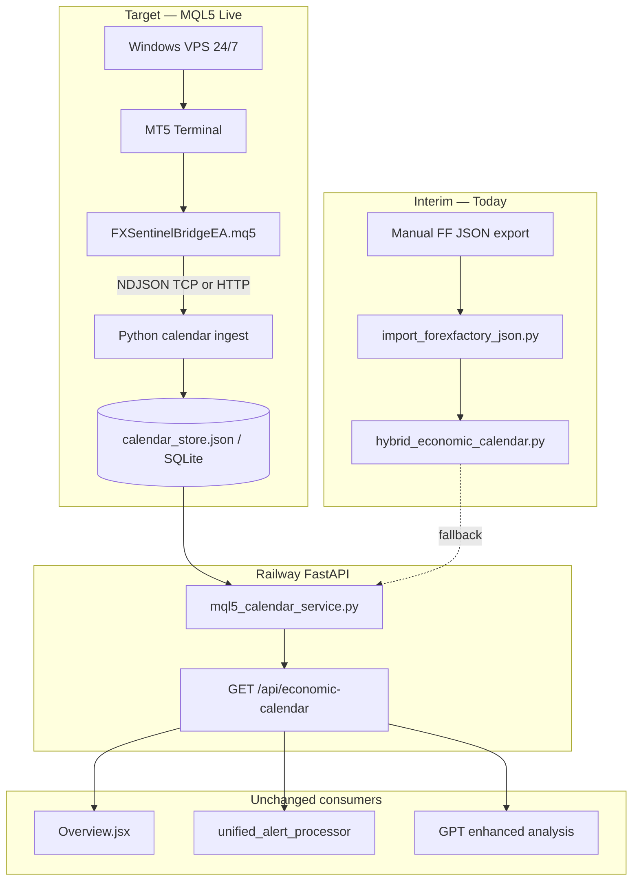

# Economic Calendar — MQL5 Live Feed Research & Feasibility

**Status:** Active — product direction confirmed  
**Date:** 2026-06-24 (updated)  
**Target data source:** **MQL5 / MetaTrader 5 economic calendar (free)**  
**Interim data source:** Manual ForexFactory export → `hybrid_economic_calendar.py`  
**Deprecated (ignore for new work):** Finnhub and other paid calendar APIs

---

## Product direction (confirmed)

FXSentinel will replace the **manual weekly calendar update** with the **free MetaQuotes economic calendar** exposed via the [MQL5 Calendar API](https://www.mql5.com/en/docs/calendar). This is the same underlying data as the MT5 terminal calendar and Tradays — no Finnhub subscription, no scraping ForexFactory at runtime.

| | Today (interim) | Target |
|---|----------------|--------|
| **Source** | Manual FF JSON export pasted into Python | MQL5 `CalendarValueHistory` + `CalendarValueLast` |
| **Cost** | Free (manual labour) | Free (MT5 calendar is built-in) |
| **Schedule** | Updated when you run import + deploy | Auto — EA polls MT5 |
| **Actuals** | Stuck at `TBD` until re-import | Live — `CalendarValueLast` on release |
| **Access** | Embedded in `hybrid_economic_calendar.py` | Windows VPS + MT5 → TCP bridge → Railway |

**Finnhub** was a previous paid API provider. It remains in a few legacy code paths (`get_economic_event_by_id`, `independent_worker`, `update_calendar_with_actuals.py`) but is **not** part of current operations or this plan. Remove those paths during implementation; do not design around them.

---

## Feasibility evaluation

### Overall verdict: **Feasible — medium effort, clear path**

Using the free MQL5 calendar for FXSentinel is **aligned with product goals and technically achievable**. It is not a drop-in library call from Railway; it requires one new infrastructure component (always-on MT5 on Windows) and a thin bridge. The rest of the app (frontend, alerts, AI analysis) already consumes a stable event schema and needs **no redesign** if the ingest layer maps MQL5 → that schema.

| Dimension | Rating | Summary |
|-----------|--------|---------|
| **Technical** | ✅ Feasible | MQL5 API is documented; bridge pattern matches planned OHLC MT5 work |
| **Cost** | ✅ Feasible | Calendar data free; ~$20–60/mo Windows VPS (shared with chart bridge) |
| **Legal / licensing** | ✅ Feasible | Calendar is a MetaQuotes platform feature; Tradays terms allow widget use — verify redistribution if republishing raw calendar to users (same as displaying FF data today) |
| **Operational** | ⚠️ Moderate | 24/7 MT5 process; monitor EA + VPS uptime |
| **Timeline** | ⚠️ 2–4 weeks | Depends on VPS provisioning; ~3–5 dev days for calendar-only bridge |
| **Risk** | ⚠️ Low–medium | Timezone mapping, VPS ops, MT5 terminal updates |

---

### What is feasible

| Goal | Feasible? | How |
|------|-----------|-----|
| Stop manual weekly imports | ✅ Yes | EA writes to backend store; no more git-deploying 26k-line Python |
| Live actuals at release | ✅ Yes | `CalendarValueLast(change_id)` — incremental diffs when values change |
| Upcoming schedule (7–30 days) | ✅ Yes | `CalendarValueHistory(from, to)` on EA boot + periodic refresh |
| Pre-event Telegram alerts | ✅ Yes | `unified_alert_processor` already reads hybrid; swap source only |
| Post-event AI analysis | ✅ Yes | Frontend triggers post-event when `actual` is real; MQL5 provides actuals |
| Zero calendar API subscription | ✅ Yes | No Finnhub, FMP, or paid REST required |
| Same data as MT5 / Tradays | ✅ Yes | Single MetaQuotes calendar database |
| Reuse chart MT5 infrastructure | ✅ Yes | Same VPS, same EA TCP client, extra message type `calendar_update` |
| Keep Overview UI unchanged | ✅ Yes | Preserve canonical schema (`expected`, `HH:MM UTC`, etc.) |

---

### What is not feasible (without the bridge)

| Approach | Why not |
|----------|---------|
| Call MQL5 calendar from Railway FastAPI directly | No HTTP API; functions are MQL5-only inside MT5 |
| Use `pip install MetaTrader5` for calendar | Python package has ticks/rates/orders only — no calendar |
| Use metatrader.com or Tradays as REST API | Web UI / widget only |
| Run MT5 on Railway (Linux) | MT5 requires Windows (or fragile Wine); not production-viable |
| Instant live calendar with zero new infra | Bridge + VPS is mandatory |

---

### Effort estimate

| Work item | Estimate | Notes |
|-----------|----------|-------|
| Windows VPS + MT5 demo setup | 0.5–1 day | Same box as planned OHLC bridge |
| MQL5 Calendar EA (poll + JSON) | 1–2 days | ~80–120 lines; `CalendarValueHistory` + `CalendarValueLast` |
| Python ingest (TCP or HTTP POST) | 1–2 days | Parse NDJSON, map fields, persist |
| `mql5_calendar_service.py` + mapper | 1 day | MQL5 structs → canonical schema; reuse `_format_event` logic |
| Wire `app.py` to new service | 0.5 day | Primary = MQL5 store; hybrid = fallback |
| Fix `get_economic_event_by_id` | 0.5 day | Query MQL5 store, not Finnhub |
| Remove / ignore Finnhub calendar paths | 0.5 day | Cleanup only |
| Timezone + impact mapping tests | 1 day | Trade server time → UTC; enum → high/medium/low |
| **Calendar-only total** | **~5–8 dev days** | Excludes VPS procurement wait |
| **If combined with OHLC MT5 bridge** | **+1–2 days** | Shared EA shell and TCP server |

---

### Cost estimate (monthly)

| Item | Cost |
|------|------|
| MQL5 calendar data | **$0** |
| Windows VPS (24/7) | **$20–60** (e.g. Hetzner, Contabo, OVH — shared with MT5 chart feed) |
| MT5 terminal + demo account | **$0** |
| Railway backend (existing) | No change |
| **Incremental calendar-only cost** | **$0** if VPS already justified for charts; otherwise VPS is the only new line item |

---

### Risks and mitigations

| Risk | Likelihood | Impact | Mitigation |
|------|------------|--------|------------|
| VPS / MT5 downtime | Medium | Empty or stale calendar | Hybrid fallback until MQL5 store recovers; health check on ingest |
| Wrong timezone (trade server vs UTC) | Medium | Alerts fire at wrong time | Convert in mapper; unit tests against known events (NFP 13:30 ET) |
| `change_id` lost on EA restart | Low | Full re-sync needed | Persist `change_id` on backend; EA sends `change_id=0` only on explicit reset |
| MT5 build update breaks EA | Low | Bridge stops | Pin MT5 build; test EA after terminal updates |
| Event title mismatch vs old hybrid | Low | AI prompts slightly different | Acceptable; MQL5 titles are authoritative |
| MetaQuotes API rate / polling guidance | Low | Throttled if poll too fast | Poll every 60–300s (MQL5 docs suggest 5–10 min for `CalendarValueLast`) |
| Calendar disabled in MT5 settings | Low | EA returns empty | Document: enable calendar in terminal settings (no MQL5 community login required) |

---

### Dependencies

```text
BLOCKING (must have)
  ├── Windows VPS reachable from internet (or VPN tunnel to Railway ingest)
  ├── MT5 terminal installed, logged in (demo sufficient for calendar)
  ├── Calendar enabled in MT5 terminal settings
  └── Outbound TCP from EA to Python ingest (or EA HTTP POST to Railway)

PARALLEL (already planned, not blocking calendar)
  ├── backend/mt5/README.md OHLC bridge — same VPS/EA pattern
  └── market_registry / ohlc_store — independent of calendar

NOT REQUIRED
  ├── Finnhub API key
  ├── Paid REST calendar API
  ├── Changes to Overview.jsx (if schema preserved)
  └── MetaTrader5 Python package
```

---

### Interim vs target architecture



---

## Validation summary (codebase checks, 2026-06-24)

| Claim | Validated? | Notes |
|-------|------------|-------|
| Production API uses hybrid only | ✅ | `backend/app.py` — manual data, no live feed |
| All events in 14-day window have `actual=TBD` | ✅ | 45/45 verified |
| MT5 bridge not implemented | ✅ | No `.mq5` files; `backend/mt5/README.md` = "Not implemented" |
| `forecast` → `expected` in API | ✅ | Overview reads `event.expected` only |
| Finnhub in legacy paths only | ✅ | Not used for production calendar display |
| MQL5 aligns with free calendar goal | ✅ | No subscription; platform-built calendar |

---

## Current state (interim — manual)

### Weekly workflow

1. Export JSON from [ForexFactory calendar](https://www.forexfactory.com/calendar)
2. Run `python3 scripts/import_forexfactory_json.py backend/ff_calendar_thisweek.json`
3. Paste into `hybrid_economic_calendar.py` → `_get_curated_events()`
4. Git commit + push → Railway deploys

See `docs/UPDATE_CALENDAR_WEEKLY.md`.

### Pain points driving MQL5 migration

1. **Manual labour** every week (or after major releases)
2. **Actuals never live** — 45/45 events in current window = `TBD`
3. **26k-line Python file** in git — hard to review and deploy
4. **Year-forcing bug** — `"Mon, Oct 6"` + `datetime.now().year` breaks at year boundaries

---

## Target: MQL5 calendar bridge

### External facts

| Fact | Detail |
|------|--------|
| [MQL5 Calendar API](https://www.mql5.com/en/docs/calendar) | Free; built into MT5; no REST endpoint |
| Key functions | `CalendarValueHistory` (boot load), `CalendarValueLast` (live diffs), `CalendarEventByCurrency` (filter) |
| Time basis | Trade server time (`TimeTradeServer`) — must convert to UTC for FXSentinel |
| `MetaTrader5` Python package | No calendar functions |
| Tradays / metatrader.com web | Same data; UI/widget only |
| Polling guidance | `CalendarValueLast` every 60–300s; store `change_id` between calls |

### Bridge design (extends `backend/mt5/README.md`)

```text
Windows VPS
  └── MT5 Terminal (calendar enabled)
        └── FXSentinelBridgeEA.mq5
              OnInit:
                CalendarValueHistory(now, now+30d) → full snapshot
              OnTimer (every 60–300s):
                CalendarValueLast(change_id) → diffs only
              Emit NDJSON:
                {"type":"calendar_snapshot","events":[...]}
                {"type":"calendar_update","change_id":N,"events":[...]}

Railway (or VPS co-located Python)
  └── mt5_bridge_server.py / calendar_ingest.py
        merge into calendar_store
        map MqlCalendarValue → canonical schema

FastAPI
  └── mql5_calendar_service.get_economic_events()
        primary: calendar_store
        fallback: hybrid_economic_calendar (until MQL5 stable)
```

### MQL5 → FXSentinel field mapping

| MQL5 (`MqlCalendarEvent` / `MqlCalendarValue`) | FXSentinel field |
|------------------------------------------------|------------------|
| Event name | `title` |
| `time` (trade server) | `date` (`YYYY-MM-DD`) + `time` (`HH:MM UTC`) |
| Currency | `currency` |
| `CALENDAR_IMPACT_*` enum | `impact` → `high` / `medium` / `low` |
| `forecast_value` | `expected` |
| `prev_value` | `previous` |
| `actual_value` | `actual` (empty → `TBD`) |
| `event_id` / `value_id` | `id` → `mql5_{event_id}_{value_id}` (stable) |
| — | `country` (derive from currency) |
| — | `currencyPairs` (derive, max 4) |
| — | `status` (`upcoming` / `today` / `completed`) |
| — | `fetched_at` (ISO timestamp for staleness detection) |
| — | `source` → `"MQL5 Calendar"` |
| — | `raw_data` → `{date, time}` for frontend sort |

---

## Canonical event schema (preserve for zero frontend changes)

```python
{
    'id': 'mql5_<event_id>_<value_id>',
    'title': str,
    'date': 'YYYY-MM-DD',
    'time': 'HH:MM UTC',
    'country': 'US',
    'currency': 'USD',
    'impact': 'high' | 'medium' | 'low',
    'previous': str,
    'expected': str,
    'actual': str,
    'source': 'MQL5 Calendar',
    'status': 'upcoming' | 'today' | 'completed',
    'type': 'Economic Indicator',
    'currencyPairs': ['EURUSD', 'GBPUSD', ...],
    'description': '',
    'fetched_at': '2026-06-24T12:00:00Z',
    'raw_data': {'date': 'YYYY-MM-DD', 'time': 'HH:MM UTC'}
}
```

**Field rename:** MQL5 uses forecast semantics → FXSentinel API uses **`expected`**. Frontend never reads `forecast`.

---

## Downstream consumers (unchanged if schema preserved)

| Consumer | Needs schedule | Needs live actuals | Changes for MQL5? |
|----------|---------------|-------------------|-------------------|
| `Overview.jsx` | ✅ | ✅ | **None** |
| `unified_alert_processor` | ✅ | ❌ | **None** (swap data source in service layer) |
| `economic_calendar_alerts` | ✅ | ❌ | **None** |
| GPT enhanced analysis | ✅ | ✅ | **None** |
| `economy_holistic_scan` | ✅ | ❌ | **None** (+ gains `fetched_at` for staleness) |
| Markets catalysts | ✅ | ❌ | **None** |

### Code that must change

| File | Change |
|------|--------|
| **New** `backend/services/mql5_calendar_service.py` | Read store; map/filter by date; fallback to hybrid |
| **New** `backend/services/calendar_ingest.py` | Accept EA payloads; merge into store |
| **New** `backend/mt5/FXSentinelBridgeEA.mq5` | Calendar polling (or extend when OHLC EA is built) |
| `backend/app.py` | `GET /api/economic-calendar` → `mql5_calendar_service` |
| `backend/app.py` | `get_economic_event_by_id` → MQL5 store (remove Finnhub) |
| `backend/independent_worker.py` | Use `mql5_calendar_service` or remove if unused |
| `hybrid_economic_calendar.py` | Keep as fallback only; stop growing embedded list |

### Deprecated — remove or ignore

| File | Status |
|------|--------|
| `backend/services/finnhub_calendar.py` | Deprecated for calendar |
| `scripts/update_calendar_with_actuals.py` | Obsolete once MQL5 actuals flow |
| `docs/SETUP_FREE_ECONOMIC_CALENDAR.md` | Out of scope (FMP/FRED — not the chosen path) |
| `global_economic_calendar.py` | Optional emergency fallback only; not the product direction |

---

## Implementation phases (MQL5-first)

| Phase | Work | Outcome | Feasibility |
|-------|------|---------|-------------|
| **1** | Provision Windows VPS + MT5 demo; enable calendar in terminal | Infrastructure ready | ✅ Straightforward |
| **2** | MQL5 EA: `CalendarValueHistory` + `CalendarValueLast` → JSON | Live data leaving MT5 | ✅ Documented API |
| **3** | Python ingest + `calendar_store` (JSON or SQLite) | Data on backend | ✅ Same pattern as OHLC plan |
| **4** | `mql5_calendar_service.py` + wire `app.py` | API serves MQL5 data | ✅ Small change |
| **5** | Hybrid as fallback; fix `get_economic_event_by_id` | Safe rollout | ✅ Low risk |
| **6** | Remove Finnhub calendar paths; stop manual imports | Clean codebase | ✅ Cleanup |
| **7** (optional) | Combine calendar messages into shared `FXSentinelBridgeEA` with OHLC | One EA, one VPS | ✅ When charts ship |

**Not in scope:** Wiring ForexFactory JSON as primary (interim hack only if VPS is delayed). Product direction is MQL5.

---

## Production security evaluation

**Verdict:** **Shippable with controls** — the MQL5 calendar idea does not introduce fundamentally new *user-facing* exposure (calendar data is already public), but it **does** introduce a new **trusted ingest path** that must be locked down. Without ingest authentication and VPS hardening, a compromised or spoofed bridge could push fake events into Telegram alerts and GPT analysis.

**Overall risk if built naïvely:** **Medium–High**  
**Overall risk with recommended controls:** **Low–Medium** (acceptable for production)

---

### Security comparison: manual today vs MQL5 target

| Aspect | Manual hybrid (today) | MQL5 live (target) |
|--------|----------------------|---------------------|
| **Data entry trust** | You only — git deploy | VPS + EA + ingest pipeline |
| **Attack surface** | Low (no runtime writer) | **New:** VPS, bridge, ingest endpoint |
| **Public read API** | `GET /api/economic-calendar` — unauthenticated | Same — unchanged |
| **Spoofing calendar data** | Requires repo access | Requires bridge secret or VPS compromise |
| **Stale/wrong data risk** | Human error | Ops + timezone bugs (not security per se) |
| **Secrets in codebase** | Alpha Vantage key hardcoded in hybrid ⚠️ | Design choice — must not repeat |

---

### Threat model

```text
                    ┌─────────────────────────────────────┐
                    │         FXSentinel (Railway)         │
                    │  GET /api/economic-calendar (public) │
                    │  POST /api/enhanced-analysis (limited)│
                    │  unified_alert_processor → Telegram  │
                    └──────────────▲────────────────────────┘
                                   │ trusts calendar store
                    ┌──────────────┴────────────────────────┐
                    │     calendar_store (must be protected)   │
                    └──────────────▲────────────────────────┘
                                   │ ingest (HIGH RISK if open)
              ┌────────────────────┴────────────────────┐
              │  Windows VPS                           │
              │  MT5 + EA → local Python → HTTPS push   │
              └────────────────────────────────────────┘
         Threats: VPS compromise, spoofed ingest, MITM, DoS payloads
```

| Threat | Impact | Likelihood (naïve build) | Severity |
|--------|--------|--------------------------|----------|
| **T1 — Unauthenticated ingest** | Attacker injects fake high-impact events → false Telegram alerts, misleading AI | High if endpoint is public | **Critical** |
| **T2 — Exposed TCP bridge port** | Anyone connects to `mt5_bridge_server`, sends fake NDJSON | High if `0.0.0.0:port` on public VPS | **Critical** |
| **T3 — VPS / RDP compromise** | Full control of calendar feed + possible MT5 account abuse | Medium | **High** |
| **T4 — MITM VPS → Railway** | Alter events in transit | Low (if HTTPS) / Medium (plain HTTP) | **High** |
| **T5 — DoS via huge snapshot** | Memory/CPU exhaustion on ingest or API | Medium | **Medium** |
| **T6 — Prompt injection in event titles** | Manipulated GPT analysis output | Low from MQL5; higher if ingest open | **Medium** |
| **T7 — Secrets in EA source** | Bridge token leaked from `.mq5` or VPS disk | Medium if hardcoded | **High** |
| **T8 — Downstream trust escalation** | Bad calendar → alerts fire without user action | Medium (alerts trust server data) | **High** |
| **T9 — Legal / redistribution** | Terms violation displaying calendar to users | Low (same as showing FF data today) | **Low–Medium** |

---

### Current codebase security baseline (relevant to calendar)

Validated against `backend/app.py` and related services:

| Control | Calendar-related status |
|---------|-------------------------|
| **Auth on `GET /api/economic-calendar`** | ❌ None — intentionally public read |
| **Rate limiting on calendar GET** | ⚠️ Only Flask-Limiter defaults (`200/day`, `50/hour` per IP) — no route-specific limit |
| **CORS** | `origins="*"` — public API pattern |
| **Auth on `POST /api/enhanced-analysis`** | ⚠️ Optional Firebase token; event body accepted from client; rate limit `10/min` |
| **Event validation before GPT** | ✅ `economic_data_validator.validate_event_data()` |
| **Stripe quota on analysis** | ✅ If `user_id` present |
| **Telegram pre-event alerts** | Trust server calendar only — **no per-event crypto signature** |
| **Telegram webhook** | ⚠️ No `X-Telegram-Bot-Api-Secret-Token` check observed |
| **Manual data path** | Trusted (git) — but `ALPHA_VANTAGE_API_KEY` hardcoded in hybrid file ⚠️ |
| **Ingest endpoint** | Does not exist yet — **design security now** |

**Implication:** Moving to MQL5 does not make the *read* path less secure. The **new risk is entirely on the write/ingest path** and VPS ops. Alerts and GPT **already trust whatever the calendar service returns**.

---

### High-risk anti-patterns (do not ship)

1. **Public `POST /api/calendar/ingest` without authentication** on Railway  
2. **TCP bridge listening on `0.0.0.0`** with no auth handshake on a public VPS IP  
3. **Shared secret hardcoded in `FXSentinelBridgeEA.mq5`** (extractable from compiled EA / logs)  
4. **HTTP (not HTTPS)** from VPS to Railway  
5. **Blind merge** — accept any JSON shape without schema validation, size caps, or idempotency keys  
6. **RDP open to the world** on the Windows VPS  

---

### Recommended secure architecture

**Preferred: co-located ingest on VPS, authenticated push to Railway**

```text
Windows VPS
  ├── MT5 + EA
  ├── Python: TCP on 127.0.0.1 ONLY (EA → localhost)
  ├── Python: validate + normalize + merge → calendar_store local buffer
  └── Python: HTTPS POST to Railway
        Authorization: Bearer <CALENDAR_INGEST_SECRET>
        (or HMAC-SHA256 over body with timestamp)

Railway FastAPI
  ├── POST /internal/calendar/ingest  (NOT public route name; or network-restricted)
  │     • Verify Bearer / HMAC + timestamp skew ≤ 5 min (replay protection)
  │     • Max body size (e.g. 2 MB)
  │     • Max events per snapshot (e.g. 2000)
  │     • Schema validation (required fields, enum impact, ISO dates)
  │     • Rate limit: e.g. 60 req/hour per secret
  └── GET /api/economic-calendar → read from store only (unchanged)
```

**Alternative:** Tailscale / WireGuard between VPS and Railway so ingest is never on the public internet.

**Why EA stays TCP client:** MQL5 limitation — but the Python listener should bind **`127.0.0.1`**, not public interface, when EA and Python share the VPS.

---

### Security controls checklist (production)

#### P0 — Must have before go-live

| Control | Purpose |
|---------|---------|
| **`CALENDAR_INGEST_SECRET`** in Railway env + VPS env (not in git) | Authenticate ingest only from your VPS |
| **HMAC or Bearer + clock skew** on ingest requests | Block replay and unauthorized writes |
| **Ingest binds localhost** or private network only for TCP | No public bridge port |
| **VPS firewall** — deny inbound RDP from `0.0.0.0/0`; allow your IP or use VPN | Reduce T3 |
| **Schema validation on ingest** | Reject malformed / malicious payloads |
| **Payload size + event count limits** | DoS protection |
| **Stable `mql5_{event_id}` keys + merge logic** | Prevent duplicate alert storms |
| **HTTPS only** VPS → Railway | MITM protection |
| **Hybrid fallback only when MQL5 store is stale** — not writable from API | Limit blast radius |

#### P1 — Should have

| Control | Purpose |
|---------|---------|
| **Ingest audit log** — timestamp, event count, source IP, `change_id` | Forensics |
| **Anomaly alerts** — e.g. >50 new high-impact events in one snapshot | Detect spoofing |
| **`fetched_at` + health endpoint** `/api/health/calendar` with freshness | Ops + auto-fallback |
| **Dedicated route limit** on `GET /api/economic-calendar` (e.g. `30/min`) | Scrape/DoS mitigation |
| **Sanitize string fields** (`title`, `description`) — max length, strip control chars | GPT injection mitigation |
| **Rotate ingest secret** procedure documented | Incident response |
| **VPS auto-updates + antivirus baseline** | Host hardening |

#### P2 — Nice to have

| Control | Purpose |
|---------|---------|
| **mTLS** between VPS and Railway | Strongest channel auth |
| **IP allowlist** on ingest (Railway edge or middleware) | Defense in depth |
| **Sign snapshots** with ed25519 key on VPS | Integrity attestation |
| **Telegram webhook secret** header validation | Separate existing gap |

---

### Downstream impact if ingest is compromised

| Consumer | What an attacker could cause |
|----------|------------------------------|
| **Telegram alerts** | Fake “NFP in 10 minutes” to all subscribed users — **reputational + trading harm** |
| **GPT enhanced analysis** | Analysis on fake event if user clicks injected row — partially mitigated by `data_validator` |
| **Overview UI** | Display fake events — misleading but no code execution (React text, no `dangerouslySetInnerHTML` on titles) |
| **Economy scan / Markets** | Skewed macro risk scores |

**Most serious production impact:** **false pre-event alerts** — users may act on fake economic releases. This is why ingest auth is **P0**.

---

### MQL5 / MetaQuotes-specific notes

| Topic | Security note |
|-------|----------------|
| **Calendar data authenticity** | Sourced from MetaQuotes servers inside MT5 — trustworthy **if** VPS and EA are uncompromised |
| **EA in Strategy Tester** | Calendar API disabled in tester — not a prod concern |
| **MQL5 `WebRequest`** | If EA POSTs directly to Railway, URL must be allowlisted in MT5 settings — prefer Python sidecar for secrets |
| **Broker credentials on VPS** | Demo account sufficient for calendar-only; isolate from live trading credentials |
| **Redistribution** | Same class of risk as displaying ForexFactory data today — confirm MetaQuotes/Tradays terms for your use case |

---

### GPT / analysis path (existing + MQL5)

`POST /api/enhanced-analysis` accepts `event` in the body (frontend sends full object). A malicious user could already spoof event fields today without MQL5.

| Mitigation | Status |
|------------|--------|
| `economic_data_validator` | ✅ Exists |
| Rate limit `10/min` | ✅ |
| Stripe analysis quota | ✅ When authenticated |
| **Server-side lookup by `id` from store** instead of trusting POST body | ❌ **Recommended improvement** — load event from `mql5_calendar_service` by ID, ignore client-supplied `actual`/`expected` except for display cache |

**Recommendation:** After MQL5 live, change enhanced analysis to **fetch canonical event from server store by `id`** and treat POST body as hints only. This closes client spoofing regardless of calendar source.

---

### Windows VPS hardening (minimum)

- Use **strong unique password** or key-based auth; disable default admin where possible  
- **Firewall:** outbound-only for EA; inbound only SSH/RDP from your IP or VPN  
- **No production broker passwords** on calendar-only box  
- **Separate Windows user** for MT5 (non-admin)  
- **Monitor:** EA process + last successful push timestamp  
- **Backups:** not critical for calendar (can resync from MQL5) — VPS is disposable if compromised: rotate secret, rebuild  

---

### Production go / no-go

| Gate | Required? |
|------|-----------|
| Ingest authenticated (secret or mTLS) | **Go blocker** |
| TCP not public OR tunneled | **Go blocker** |
| Schema + size validation on ingest | **Go blocker** |
| HTTPS VPS → Railway | **Go blocker** |
| VPS firewall + restricted RDP | **Go blocker** |
| Health/freshness monitoring | Strongly recommended |
| Server-side event lookup for analysis | Recommended before marketing “live calendar” |
| Legal review of calendar redistribution | Recommended (low urgency if status quo) |

**Conclusion:** Implementing MQL5 calendar in production is **security-feasible** and does not require exposing MetaTrader to end users. The calendar remains read-only public data. The **non-negotiable** requirement is treating **ingest as a privileged, authenticated, validated write path** — same seriousness as a webhook or admin API. Building a public unauthenticated ingest endpoint would be a critical vulnerability.

---

## Known tech debt (fix during MQL5 rollout)

| Issue | Fix |
|-------|-----|
| Year-forcing on `"Mon, Oct 6"` | MQL5 provides full timestamps → store `YYYY-MM-DD` |
| `get_economic_event_by_id` → Finnhub → mock NFP | Query `mql5_calendar_service` by `id` |
| `independent_worker` → Finnhub | Align to MQL5 service or deprecate worker |
| No `fetched_at` on events | Set on every ingest merge |
| `MarketResearch.jsx` uses `time_utc` | One-line fix: use `c.time` |
| Legacy `robust_alert_service` / `background_alert_service` | No timing logic — do not use for production alerts |

---

## Alignment checklist

| Question | Answer |
|----------|--------|
| Is free MQL5 calendar the right data source? | **Yes** — matches goal, zero API cost |
| Does it replace manual updates? | **Yes** — after bridge is live |
| Does it provide live actuals? | **Yes** — via `CalendarValueLast` |
| Can Railway call MQL5 directly? | **No** — bridge required |
| Is the bridge feasible? | **Yes** — ~5–8 dev days, documented API |
| Does it fit existing app architecture? | **Yes** — schema-preserving swap at service layer |
| Is Finnhub part of the plan? | **No** — legacy only |
| Should we use FF JSON API instead? | **No** — not the product direction; no actuals in that feed anyway |

---

## Draft message for collaborators

> **Direction:** FXSentinel is moving from manual ForexFactory imports to the **free MQL5 economic calendar** via an MT5 bridge. Finnhub is deprecated and not part of the plan.
>
> **Today:** `hybrid_economic_calendar.py` (~26k lines) is updated manually weekly. All actuals in the current window are `TBD`. Production = `GET /api/economic-calendar` only.
>
> **Target:** Windows VPS + MT5 + EA polling `CalendarValueHistory` / `CalendarValueLast` → JSON to Railway ingest → `mql5_calendar_service` → same canonical schema. Frontend, alerts, and AI analysis unchanged.
>
> **Feasibility:** Medium effort (~5–8 dev days for calendar), ~$20–60/mo VPS (shared with planned chart bridge). Not callable from Python/Railway directly — bridge is mandatory.
>
> **Ask:** Help design the EA polling loop, `change_id` persistence, and trade-server-time → UTC mapping.

---

## Related links

- [MQL5 Economic Calendar API](https://www.mql5.com/en/docs/calendar)
- [MQL5 article: CalendarValueLast in production](https://www.mql5.com/en/articles/22196)
- [MQL5 Python integration](https://www.mql5.com/en/docs/python_metatrader5) (no calendar — bridge required)
- [MetaTrader economic calendar (web UI)](https://www.metatrader.com/en/economic-calendar)
- Internal: `backend/mt5/README.md`, `docs/MARKETS_CHART_DATAFEED_EVALUATION.md`

---

## Files reference

| File | Role |
|------|------|
| `backend/services/hybrid_economic_calendar.py` | **Interim** manual source + `_format_event` reference |
| `backend/mt5/README.md` | Planned MT5 TCP bridge (shared with OHLC) |
| `backend/app.py` | Calendar API endpoint |
| `backend/services/unified_alert_processor.py` | Production pre-event alerts |
| `src/components/Overview.jsx` | Calendar UI (no changes expected) |
| `scripts/import_forexfactory_json.py` | **Interim** manual import tool |
| `backend/services/finnhub_calendar.py` | **Deprecated** — remove |
| `docs/UPDATE_CALENDAR_WEEKLY.md` | **Interim** manual process — retire after MQL5 live |
